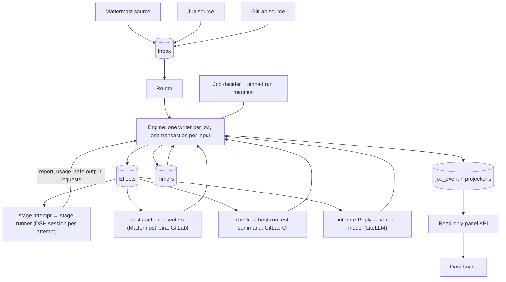

# Design and Architecture

This document says how Workflow Agent works. It implements the [PRD](PRD.md); the reasons are in [DECISIONS](DECISIONS.md), setup and operations in [DEPLOYMENT](DEPLOYMENT.md), upstream provenance in [UPSTREAM](UPSTREAM.md). The `D`, `F` and `A` ids name the decision, requirement or acceptance criterion a mechanism serves.

## 1. Overview

Workflow Agent is a Cordis bundle on DeepSeek Harness (`dsh --profile workflow-agent`). DSH runs the agent sessions, the LLM routes and the sandboxes. **The workbench** is Workflow Agent's host process, the plugin inside DSH: it owns the work model (jobs, stages, gates, budgets and external writes), holds the credentials and serves the dashboard. No model routes work between stages, and no long-lived "orchestrator" session exists.

The code has four layers. The kernel imports only Node and `zod`; the domain imports only the kernel and `zod`; `tests/layering.spec.ts` checks both.

| Layer | Directory | What it is |
| --- | --- | --- |
| Kernel | `src/kernel/` | A durable, single-writer job engine on SQLite: inbox, engine, effects, timers, projections, blobs, versioned definitions and run manifests, recovery. It knows nothing about workflows. |
| Domain | `src/domain/` | The workbench's rules as pure functions: workflow definitions, policy, the router, the job decider (stages, checks, gates, budgets) and the reply vocabulary. |
| Adapters | `src/adapters/` | The domain connected to the outside: the stage runner on DSH, tools, writers, checks, the reply verdict, message rendering, sources to the inbox, and demo mode. |
| Composition | `src/index.ts`, `src/app/`, `src/workflows/`, `src/sources/`, `src/client/` | The `workflow-agent` plugin, the runtime that wires everything, the shipped workflows, the connectors and the read-only dashboard. |

One job, from start to finish:
1. A Source polls Jira or Mattermost and appends each new post or comment to the inbox before it moves its cursor.
2. The router sends an addressed request (a mention or a direct message) from an allowed sender to intake. Intake picks the workflow by its triggers, and the job pins a run manifest.
3. The decider starts the first stage as a `stage.attempt` effect. The stage runner creates a fresh DSH session for the attempt, and the model works in the job's worktree with the stage's tools.
4. The model ends the attempt with `workbench_stage_report`. The report is a proposal: the job validates it, runs the stage's checks on the host, and only then applies the transition table.
5. A gate, such as a plan approval, is posted to the job's thread. The job waits without holding a worker. A reply is admitted and interpreted by the rules in [§3.4](#34-gates-and-replies).
6. The job moves on, backtracks, blocks on a budget, or completes. Every step is an event in `job_event`, and the dashboard reads the projections of those events.

## 2. Kernel (`src/kernel/`)

Everything that changes a job happens in one SQLite transaction (`node:sqlite`, WAL, `synchronous = FULL`). The transaction consumes the input, runs the decider, appends events, applies projections, inserts effects and timers, and stores the outcome. `node:sqlite` is synchronous, so two decisions for the same job cannot interleave: the transaction is the job's mailbox.

| Part | File | Responsibility |
| --- | --- | --- |
| Database | `db.ts` | One connection and forward-only migrations per owner. The kernel's schema comes first, then the domain's. A database newer than the build is refused unchanged. |
| Inbox | `inbox.ts` | Every outside input is appended before anything acts on it. Appending is idempotent on `(source, externalId)`, so a source may deliver the same event again after a crash. |
| Engine | `engine.ts` | Each input (an inbox event, an effect result, a timer, a tool call) is an origin, consumed exactly once. A redelivered origin returns its stored outcome. A decider error faults that one job instead of blocking the input. |
| Effects | `effects.ts` | Outside work as rows: claimed when due, run by a handler, and settled in the same transaction that hands the result back to its job. Concurrency is limited per kind. Effects that share an `ordering_key` run in order. A write whose outcome is unknown is reconciled before it runs again. Long effects (stage attempts, checks, the setup step) hold their slot until they end. A **notice** is an effect with no job: intake queues it with the settlement of an event that starts no job, keyed by the event, so it is posted once (`A20`); its result is recorded on its row. |
| Timers | `timers.ts` | Durable reminders and deadlines, fired to their job as commands. The job decides whether the timer's subject is still current, so a stale timer does nothing. |
| Projections and blobs | `projections.ts` | Read tables kept up to date from events in the same transaction, and rebuildable by replaying `job_event`. Large content (artifact text, logs) is stored once per SHA-256 digest. |
| Registry | `registry.ts` | Versioned workflow definitions and the manifests jobs pin. A definition is `(id, version)` plus a canonical hash of its declaration and prompts. The same id and version with another hash is refused. Guards (pure functions) are registered by name. |
| Recovery | `kernel.ts` | On start, an effect that was `running` is settled as interrupted and returned to its job, which decides what to do. Unconsumed inbox events and due timers are processed. |

**One decision, one transaction.** For each input the engine, in one `BEGIN IMMEDIATE` transaction:
1. checks that the origin is unconsumed; a consumed one returns its stored outcome, so redelivery is a no-op;
2. loads the job row and runs the decider's `decide`;
3. folds the events with `evolve`, appends them to `job_event` and runs the projections;
4. inserts the effect and timer rows the events ask for;
5. updates the job row with `version = version + 1` where the version is the one it read;
6. marks the origin consumed and stores the outcome.

A rejection also consumes the origin, so a bad input never retries forever. If `decide` or `evolve` throws, the transaction rolls back, and a second one consumes the origin with a fault and marks the job `faulted`: a deterministic decider would throw again. A faulted job shows on the dashboard and takes only the commands its decider accepts when faulted, such as cancel. A database error (for example, busy) is not a fault and is retried.

**Effect rules.**
- An effect's idempotency key comes from the job, the origin and the effect's place in the decision, so a redelivered input yields the same keys.
- A failed effect does not hold back the next one on its `ordering_key`; its job learns of the failure as a command and decides.
- A decision cancels effects by kind and ordering key: a pending one is cancelled in the transaction, a running long one is stopped through its handler's `cancel`. A running short one finishes, and its job ignores a result it no longer needs.
- A handler whose write is not idempotent must have `reconcile`; such a kind is refused at registration otherwise. On recovery a running short effect becomes `unknown`: with `reconcile`, a found write succeeds and an absent one runs again; an idempotent kind simply runs again. A long effect whose work did not survive (a stage session) returns to its job as interrupted.

Together these give `A11`: a crash or restart at any point loses no inbound event, timer or tool result, and repeats no external write. `tests/kernel-properties.spec.ts` and `tests/domain-properties.spec.ts` inject crashes at every commit point to check it.

## 3. Domain (`src/domain/`)

The domain is pure. The decider reads the pinned workflow, the registered guards and the current policy through lookups. Manifests and blobs never change, so the same input always gives the same decision.

### 3.1 Workflow definitions and run manifests

A workflow (`definition.ts`) is declarative data, validated when it is defined. It declares:
- `triggers`: the sources and the kinds of message (`mention`, `direct`) that may start it, with an optional text pattern;
- `stages`: each one's agent preset, permission preset, network profile (`egress`), instructions (a prompt text), write tools, output schema, optional artifact, question rounds, checks and per-attempt limits;
- `transitions`, optionally through a gate or a guard, and `backtracks` with a budget per edge;
- `gates`: approvals, with a reminder and a deadline;
- `budgets` per job (turns, tokens, backtracks) and the `extension` an approval grants;
- `reopen`: the stage that feedback on a completed job's merge request reopens;
- `places` (optional, `D12`): where each conversation happens, as `clarification`, `plan` and `code`, each `chat` (the job's Mattermost thread), `ticket` (its Jira issue) or `mergeRequest`. See [§3.6](#36-places-and-conversations).

Prompts may contain `{{name}}` placeholders. A deployment fills them with its workflow parameters (for example `{{testCommand}}`): the chosen repository's ([§3.2](#32-router-and-intake)), then the workflow's own, which are kept over the repository's. A check may run only for jobs whose frozen parameter has a value (`when: { parameter, equals }`), so a job's check list is fixed when its manifest is pinned; a job without that parameter runs the check, so a typo or a job with no repository never drops a required check.

At intake the job pins a **run manifest**. The manifest freezes the definition and prompts by digest, and for each stage the model, the reasoning effort, the presets, the egress profile and the tools. It also freezes the verdict model, the policy version, the deployment's workflow parameters and the job's repository profile. Changing a workflow, a prompt, a model or a parameter therefore affects only new jobs (`A13`). A transition whose guard is not registered parks the job instead of failing it. `resume` re-evaluates the transition once the guard is back.

Shipped workflows (`src/workflows/`):
- **`standard-delivery@13`.** `(setup) → inspect → plan → (plan approval) → implement → completed`, with places: questions in chat, the plan and its approval in the ticket, code on the merge request. Implement completes only when its checks pass for the pushed commit (the host-run tests, GitLab CI unless the repository has none, test integrity and the clean-context review, [§4.5](#45-checks)), and the job then completes with its merge request open. Review feedback on that merge request reopens the job at `review`. Backtracks are `plan → inspect`, `implement → plan | inspect` and `review → plan | inspect`, each with a budget.
- **`synthetic-hotfix`.** `triage → patch → notes`, started by a text pattern. It is the second workflow of `A6` and the one the demo runs.

A deployment adds its own workflows as modules (`workflows.modules`, see [DEPLOYMENT §3](DEPLOYMENT.md#3-configuration)).

### 3.2 Router and intake

The router (`router.ts`) is a pure function from an inbox event to where it goes. No model is involved:
- a reply on the thread of an open gate goes to that gate;
- a message on a thread bound to an active job is a follow-up, and on a completed job's merge request thread it may reopen the job (only the merge request: a comment on a done job's ticket is routed like any other, except a `close`, which reaches the job on any of its threads);
- a machine fact (a pipeline result, a merged merge request) goes only to the job bound to its thread, and never answers a gate;
- only an explicit mention of the bot or a direct message, from an allowed sender, matching a workflow trigger, starts a job (`A18`). A new Jira issue, being in a source's filter, an unaddressed post and a GitLab event never start one.

Workflows whose triggers all have a pattern are tried before catch-all ones.

**Choosing the repository** (`repositories.ts`, `A20`). For a workflow that declares `repository: true` (`standard-delivery` does), in a deployment with repository profiles, a new job's repository is chosen from its trigger, in this order:
1. any `repo:` token in the message (any case, with markdown, quote or bracket marks and a space after the colon allowed), which must name exactly a configured name or project path, every token agreeing;
2. the Jira project of the trigger's thread (`jira:<PROJECT>-<n>`);
3. the Mattermost channel of its thread;
4. the deployment's default.

Overlapping rules (a Jira project or channel in two profiles, two defaults) are refused when the configuration loads, so the choice never depends on order. Three cases start no job (`D10`):
- **A contradicting `repo:`.** When the thread maps to a repository by its Jira project or channel, a `repo:` naming another one is refused.
- **A sender the repository does not list.** A repository with its own `senders` refuses any sender they do not list, after the global sender check of `A18`.
- **No repository.** A `repo:` token naming anything else (a typo, a trailing colon, a path below a project), or no rule and no default. A token never falls back to another rule, and the reply lists only the repositories the sender may use.

In each case the event is settled `ignored` with the reason, and a notice saying why is posted on its thread. The intake decision records the repository, the rule that chose it and the sender rule that allowed it; the manifest freezes the whole profile. Other workflows, and every workflow with no profiles (the demo), get no repository and no setup step.

### 3.3 Job decider

A job's rules (`decider.ts`) as pure functions over its state, its manifest and the current policy:
- **Stage attempts.** Each attempt is a long `stage.attempt` effect with a fresh session. A completed report is validated against the stage's output schema. If the stage has checks, the job moves to `verifying`, and only passing required checks let the transition run. A failed check starts a new attempt with the failure as input. A second report for an attempt that already reported is rejected.
- **Questions.** A stage may report `question` with all its open questions at once. They are posted as one question gate, a round. Without places, the first eligible answer on the bound thread closes the gate and starts a new attempt with the answers. With places, each reply is read item by item and the round closes only when every item has an answer ([§3.6](#36-places-and-conversations)). `questionRounds` limits how many rounds a stage may ask.
- **Retries and limits.** Turns, tokens and wall-clock time per attempt fail the attempt. A failed, interrupted, timed-out or over-limit attempt is retried within the stage's attempt budget, with a note on what happened.
- **Budgets.** Turns and tokens per job, attempts per stage visit, and backtracks per edge and in total are budgets. When one runs out, the job blocks and opens a resume gate to its approvers. Approving adds the amount the workflow declares under `budgets.extension` and resumes. A cancel cancels the job (`A16`).
- **Follow-ups.** A message from an eligible person on a bound thread is steered into the running attempt, or kept as input for the next one. With places it is read first, and a question gets an answer turn instead ([§3.6](#36-places-and-conversations)). A merge request comment is never steered into a stage other than review: it is kept, and a job that would complete with one kept reopens at review instead.
- **Cancellation.** An approver's cancel (`stop`, `/cancel`, `стоп`, or a cancel verdict) stops the running attempt and the job.
- **Setup.** A job whose manifest has a repository starts in `setting_up`, with a long `setup` effect ([§4.9](#49-setup-step)), before its first stage. `passed` records the installed toolchains on the job (`SetupCompleted`) and starts the first stage. `blocked`, a malformed result or a handler failure blocks the job with the evidence (`setup_blocked`); `ok` runs the step again, using no attempt, and `stop` cancels. A restart that interrupts it runs it again once; interrupted again, the job blocks (`setup_blocked`). Cancelling the job stops it.

### 3.4 Gates and replies

An approval gate is bound to one artifact revision (its SHA-256 digest) and one thread. A reply counts only when all of these hold:
1. **Admission, deterministic.** The actor is eligible for the gate's role, the reply is on the gate's bound thread, and it was posted after the gate's post (server times from the same source). The workbench can never answer its own gate.
2. **Meaning.** A short standalone approval with no qualifier (`ok`, `LGTM`, `go ahead`, `ок`) or a cancel (`stop`, `/cancel`, `стоп`) is decided by the English and Russian vocabulary (`vocabulary.ts`) without a model. Anything else becomes an `interpretReply` effect. The verdict model reads the reply as quoted data and answers with a strict JSON verdict: `approve`, `approve_with_notes`, `request_changes`, `question`, `cancel`, `unrelated` or `unclear`, with a confidence.
3. **Safety.** Only `approve` and `approve_with_notes` at confidence `0.8` or more approve. Anything malformed, unclear, low-confidence or missing (the model is unavailable) never approves: the workbench restates how it read the reply and the gate stays open. Every approval is acknowledged with what was approved.
4. **Order.** A gate's replies resolve in the order they were posted. Model interpretations of one gate run one at a time, and a quick vocabulary approval waits behind an earlier pending interpretation. A cancel acts at once. A verdict that arrives after its gate closed is recorded as a refused reply.
5. **Revisions.** A new artifact revision gets a new gate, so a reply posted before it is refused. An expired gate blocks the job, and it never approves.

`request_changes` and `question` start a new attempt of the gated stage with the reply as input. With places, `question` gets an answer turn and the gate stays open ([§3.6](#36-places-and-conversations)). Notes from `approve_with_notes` go to the next stage as input. `A5` and `A12` are covered by `tests/domain-scenarios.spec.ts` and the property suite. The labelled reply set is measured with `pnpm eval:replies` ([DEPLOYMENT §5](DEPLOYMENT.md#5-operations-and-verification)).

### 3.5 Policy

The policy (`policy.ts`) is deployment configuration (`D9`). It holds allowed senders per source, approvers per workflow and source (`*` means every allowed sender of that source), the approvers of each repository that lists them, and the workbench's own identities per source. It has three roles:
- `sender` starts a job;
- `approver` resolves approval and resume gates, and cancels or retries the job: the requester (while still an allowed sender) or a workflow approver. For a job whose repository lists `approvers` (`D12`), only they do, the requester included, in every source; the runtime resolves their emails to Jira and Mattermost users at startup, and until it has, nobody approves (it fails closed);
- `respondent` answers questions: an approver or an allowed sender, and, for a workflow with places, anyone in the job's thread (`D12`).

Eligibility is evaluated against the current policy, so removing someone applies to running jobs too.

### 3.6 Places and conversations

A workflow with `places` (`D12`) puts each conversation of a job where it belongs. Each gate opens on its place's thread (`placeThread` in `decider.ts`): question and resume gates on the `clarification` place, approval gates on the `plan` place. A place the job has no thread for yet falls back to the chat thread, then to the trigger's thread. The job's outcome is posted on the clarification place.

`standard-delivery` declares `{ clarification: 'chat', plan: 'ticket', code: 'mergeRequest' }`. A workflow without places keeps every gate on the thread that started the job. The posts quoted below are the English ones; each has a Russian wording too.

#### The chat thread

- A job started in Mattermost uses its trigger's thread.
- A job started in Jira or by a direct message asks for a thread in its repository's first mapped channel (`ChatRequested`), says so where it started, and holds its first stage until the thread is open (`ChatOpened`).
- A repository with no mapped channel refuses such a job (`no_chat_channel`).

#### The ticket

- A Jira issue key in the trigger (`do ORD-300`) is linked at start, so the ticket is bound before the plan. The plan and each revision are posted as a Jira comment, and the chat thread gets one line with a link.
- A trigger outside Jira that names no issue key starts no job. The router answers it with a `no_ticket` notice ([D12](DECISIONS.md#maintainers-answers-2026-11-13)), which says the job did not start, names the repository's Jira projects when it maps any, and gives an example with the bot's own name and a key of the first project.
- When the repository maps Jira projects (`match.jira`), only a key of one of them counts, so `UTF-8` or another project's issue mentioned in passing is not the job's ticket.
- A job whose ticket cannot be linked at start fails with the reason, rather than planning outside Jira.
- A workflow with places but no repository is not held to this, and keeps a plan with no ticket in the chat thread.

#### Question rounds

- **Addressed.** A round is addressed to the ticket's author, matched to a Mattermost user by email, else to the requester.
- **Read item by item.** Each reply becomes a `readAnswers` effect. The verdict model says which open items the reply answers, a question it asks back, items it redirects to someone (`@name`; a redirect counts only when the reply mentions that name with `@`), or that the reply is talk unrelated to the questions.
- **Recorded.** The answers are recorded with who gave them, and the bot posts what this reply changed (the items it answered, the person an item was passed to, as a mention) and what it still waits for.
- **Redirects.** The gate remembers each redirect, and the next reading is told which items were asked of whom and who replies, so that person's unnumbered reply is read as about their items.
- **Closing.** The round closes when every item has an answer, and the next attempt gets the answers item by item, people named as `@username`.
- **Several answers.** A person's later answer to an item replaces their earlier one, and both are marked. Answers of different people all stay, and the stage names a conflict and whose answer it follows.
- **"I don't know, you decide"** is an answer: the plan states it as an assumption.
- **Unmatched replies.** A reply that tries to answer but cannot be matched changes nothing but a request to answer by number; an unrelated one changes nothing and gets no post.

#### Answer turns

A question to the workbench becomes an `answer` effect: one model call with no tools, on the job's context (the request, the ticket, the answers, the current plan and, on a merge request, its diff). The answer is posted where the question was asked. It makes no plan revision and no stage attempt, and its tokens count against the job's budget. Four things count as such a question:

- a question back in a round;
- a `question` verdict at an approval gate;
- a question about the plan from someone who may not approve;
- a follow-up the `interpretFollowUp` effect reads as a question.

#### Merge request comments

- **Discussions.** The poller reads notes through their discussions, so each message keeps its discussion (`replyTo`): an answer, an answer failure and the news of a proposal go into that discussion, and a reopened attempt's input names it so the agent replies there too. If GitLab refuses a reply in a discussion, the post becomes a new note.
- **Five kinds.** The `interpretFollowUp` reading is given the approved plan and tells five kinds apart: a question (answered there), a change within the plan (`request_changes`), a change of its requirements (`changes_requirements`: new or changed behaviour, inputs, outputs, errors or interfaces, or dropping something the plan has), an approval or thanks (with or without notes), and unrelated talk.
- **What changes nothing.** Only a confident plain approval or thanks: it neither reopens a finished job nor waits for the next attempt. Everything else (an approval with notes, information, talk) is a follow-up, so nothing the job needs is lost; an unsure reading is one too.
- **Change requests.** One that arrives while another stage runs is kept for review: a retry of implement after a red check does not take it, and when implement completes it reopens the job at `review`.
- **Requirement changes.** A change of the requirements is a proposal (below), never a change made in the code first. A workflow without `reopen.requirements` sends every change to `reopen.stage`.

#### Change proposals

A comment read as changing the requirements (`changes_requirements`, on any thread of the job, or a change asked for on the plan by someone who may not approve) becomes a `Proposal` on the job (`ProposalRaised`): its text, who asked, where (with the merge request discussion) and a status ([D12](DECISIONS.md#after-the-maintainers-trial-2026-11-14)).

- **Who decides.** A proposal an approver raises is accepted at once. Any other is put to the approvers in the ticket: on the open plan approval, else on a gate of kind `proposal` that does not stop the job (its status and the dashboard's summary stay as they are) and stays open when the job finishes.
- **Reading the decision.** The approver's reply is read with the pending proposals, numbered as posted, and the verdict carries a decision per proposal (`ProposalDecided`). The vocabulary fast path does not apply while proposals are pending. Only explicit decisions count, on the proposals the reply was read with; each proposal keeps its number (`p2` is 2) in every post, and each request lists all pending.
- **On a proposal request,** a plain yes accepts them all. An approver's reply that decides nothing is read as it would be without the request (a follow-up, or a new proposal), and a non-approver's too. A cancel word cancels a running job but not a finished one.
- **On the plan approval,** accepting any proposal makes a revision, declining all lets the approval stand, and an approval that leaves one undecided is restated.
- **Accepted proposals** go to the workflow's `reopen.requirements` stage (`plan`): a finished job reopens there, a running attempt of that stage is told, an open approval becomes a revision, and otherwise the job goes there instead of completing (before review takes any kept code fix). That stage gets every accepted proposal as a requested change, and the plan lists them.
- **Statuses.** Opening the next approval marks the accepted proposals `included` in that revision, its approval `approved`, and the job's completion `done`.
- **News.** The person who asked hears each step where they asked: passed to the approvers, accepted, declined, approved in revision N, done with the commit. A step decided in the ticket itself is not repeated there.
- **Steering.** An accepted proposal counts as given to a running plan attempt only when the steer reached it. A revision includes only the proposals its attempt was given, and one that missed it gets another revision before the approval opens. A steer result that arrives after its attempt reported changes nothing.
- **Reminders and deadlines.** Proposals still pending when an approval closes for a revision get a new request. A request has the plan approval's reminder and deadline, started again when a proposal joins it. At the deadline its pending proposals are dropped, as are those of a request that could not be posted, and a job's open proposals when it is cancelled or fails, each with news where it was asked.
- **Facts after completion.** A finished job still hears a fact that would have completed it (`completeOn`; `standard-delivery` declares `mr_merged` and `mr_closed`, a merge request closed without a merge): it closes (`JobClosedByFact`), drops its open proposals, and takes no more feedback or proposals. Other facts after completion are not routed.

#### Replies from someone who may not approve

On an approval or proposal gate, their reply is read by `interpretFollowUp` with `questionOnly`:

- a question is answered;
- an approval does not count, and they are told who approves ("@dev-ivan, only @lead-1 can approve the plan", `NonApproverReplied`);
- a change they ask for is a proposal, put to the approvers with a line that only they change the plan;
- unrelated talk gets nothing.

An approval written in the chat thread while the plan waits in the ticket is pointed there (`ApprovalElsewhere`), and neither approves nor is kept. Approvers are named as `deciders()` resolves them: mentioned (`@name`, `[~name]` in Jira) by their name in the post's own source, written plainly when known only in another.

#### The completion post

- A job that hands over a merge request says the implementation is ready for review, with the merge request, the last commit, the passed checks in words and that comments on the merge request reopen it. After a reopening it says it reworked the change.
- A job that ends without a merge request, or by a fact such as a merged merge request, says "The job is done".
- Links in posts use the address people open Jira at (`dashboard.links`), else the connector's.
- With a passed review that gave a merge risk, the post adds a list item (the level and what floored it, with the two worst gaps under it), and the merge request, when the job has one, gets a note with the whole summary, the commit and the review's claims the diff did not back.
- The risk level is the host's: the weighted mean of the reviewer's five categories (alignment, impact, verification, rollback cost, error detection), at least medium when a sensitive area is touched (migrations, auth, secrets, dependencies, CI, infrastructure, by path) or impact or rollback is at its worst.

#### How posts read

Every post has the same shape in Mattermost, Jira and GitLab (`messages.ts`):

- It opens with an emoji for its kind (❓ questions, 📋 plans, ✅ done or approved, ⏸ paused, ❌ failed, 🔁 change proposals, ℹ️ notes, ⚠️ warnings) and a short headline.
- The facts follow, each on its own line or as a list item; people's and a model's words are quoted.
- After a blank line, a `👉` line says what to answer.
- Blocks are separated by blank lines, so a list never swallows the line after it. A plan sits between rules.
- A merge request is named by its project and number, a ticket by its key, each linked. A proposal keeps its own number as a bullet's bold label.
- GitLab renders a single newline as a space, so on a merge request every line that does not start a block ends in a hard break (`hardBreaks`).
- The merge-risk note lists the five categories with a colour each (🟢 🟡 🔴, ⚪ not applicable) and the gaps under them; the review's unverified claims say their severity and why, in the post's language.
- The agents' own comments (the scope in Jira, the merge request's link, replies on the merge request) are told to follow the same layout (`STYLE`), and the host keeps the lines of an agent's merge request reply (`hardBreaks` in the `gitlab.reply` action).

#### Cancelling and closing

- **Cancelling.** Only a command-shaped reply cancels (`stop`, `cancel`, `/cancel`, `стоп`, `отмена`, …), and only from an approver. A sentence such as "no need" ("не надо", "не нужно") is an answer in a round, not a command.
- **Closing.** A finished job that no fact closed (a workflow without `completeOn`, a merge request left open) is closed by an approver's standalone `close` (`close job`, `закрой`, `закрыть`, …) on any of its threads ([D12](DECISIONS.md#closing-a-finished-job-2026-11-15)). There is no slash form, since `/close` is a GitLab quick action.
- **Routing a close.** The router passes a close on the job's Jira ticket or Mattermost thread to the newest finished job bound there that is not closed yet, though only its merge request takes other feedback.
- **What a close does.** The job records `JobClosed` (who, where), drops its open proposals with their news, and posts "🔒 **Task closed** — @lead-1." where it was asked; anyone else is told who may (`CloseRefused`). A reading of an earlier comment that returns after the close changes nothing, and a merge request closed without a merge is still watched, so a later merge is reported.
- **After a close.** A closed job, or one a fact completed while it ran, tells each thread once that it is closed when someone writes there (`ClosedJobAddressed`), then ignores it. The dashboard says "Closed" in the list and who closed it in the "Now" box.
- **Any version.** Closing is host logic, so a job pinned to an older workflow version closes the same way.

## 4. Adapters (`src/adapters/`)

### 4.1 Core plugin and composition

The `workbench` plugin (`workbench-plugin.ts`) owns the kernel and the domain, and provides typed services: `wbStore`, `wbInbox`, `wbWorkflows`, `wbEffects` and `wbPolicy`. `WorkbenchRuntime` (`src/app/workbench-runtime.ts`) is the composition root:
- it resolves the configuration;
- it registers the workflows, the effect handlers and the tools;
- it gives the Sources their context;
- it merges `WORKBENCH_ALLOWED_SENDERS` and resolved Mattermost user ids into the policy, and resolves each repository's approvers by email in Jira and Mattermost, retrying until both answer;
- it starts and stops the dashboard's server ([§6](#6-read-only-supervision-dashboard)).

### 4.2 Stage runner

The `stage.attempt` handler (`stage-runner.ts`):
- Each attempt gets a fresh DSH session (`wb-<attemptId>`). The session is created under the stage's agent preset, pinned to its permission preset, and set to the model and effort the manifest froze. Working directory: the job's worktree under `workRoot`.
- The stage's instructions are a system-prompt section. The first message holds the request, the job's ticket (its bound Jira issue, `D12`), the attempt's typed inputs (answers, approval notes, requested changes, follow-ups, check failures, a recovery note) and the current artifacts.
- The model ends with `workbench_stage_report` (`completed`, `question`, `backtrack` or `blocked`). That becomes the job's `report` command. A refused report returns to the model as the tool's error, so it can correct it.
- Usage on each `assistant/message` feeds the budgets.
- A turn that ends with no report gets two reminders, then the attempt ends and the job decides.
- The attempt holds its worker slot (`executor.maxWorkers`) until it ends, so a job waiting on a person holds none (`A3`). Cancelling stops the session. When an attempt ends, its background jobs are stopped, its egress proxy socket is closed, and its session is archived.

### 4.3 Tools

Every stage gets the connector **read tools** (`read-tools.ts`), which use host credentials the session never sees: `jira_get_issue`, `jira_get_issue_links`, `jira_get_epic_context`, `jira_get_attachments`, `jira_read_attachment_text`, `jira_search_issues`, `mattermost_get_thread`, `mattermost_resolve_users`, `gitlab_get_mr`, `gitlab_list_discussions`.

**Write tools are safe outputs** (`safe-output.ts`, `D8` decision 6). A write tool holds no credential. It checks the request against the job's scope and submits it to the job as an `action`. The job checks the action against the stage's declared tools and turns it into an effect. The tool waits for the effect's result (for example the MR URL); after its timeout it answers `queued`, and the result reaches the session as a notice. Scope: Jira writes go to the job's own issue; GitLab writes go to the job's repository, on `agent/…` branches no other job uses, and to merge requests bound to the job; Mattermost posts go to threads bound to the job.

| Action | Tool |
| --- | --- |
| `mattermost.post`, `mattermost.createChannel` | `mattermost_post_message`, `mattermost_create_channel` |
| `jira.link`, `jira.comment`, `jira.transition`, `jira.updateFields` | `jira_link_issue`, `jira_add_comment`, `jira_transition_issue`, `jira_update_fields` |
| `gitlab.push`, `gitlab.createMr`, `gitlab.updateMr`, `gitlab.reply` | `gitlab_push_branch`, `gitlab_create_mr`, `gitlab_update_mr`, `gitlab_reply_discussion` |

### 4.4 Writers and reconciliation

The `post` effect (the workbench's own messages) and the `action` effect run in `writers.ts`. Each non-idempotent write carries its idempotency key where the source can hold it unseen, so a write whose outcome is unknown is found again before it is repeated:
- a Mattermost post, in the post's `props`;
- a GitLab note, in an HTML comment (`<!-- workbench:<key> -->`);
- a Jira comment, by its exact body (comments are converted from Markdown to Jira wiki markup, `src/infra/jira-markup.ts`, before they are posted and when they are looked up);
- a merge request, by its source branch.

Transitions, field updates, non-force pushes of a given commit and MR edits are idempotent, and simply run again. A 4xx fails the write for good. A 5xx or a network error leaves the outcome unknown, so the kernel reconciles. A post returns the server's creation time, which gate admission compares with replies. Messages to one thread share an `ordering_key`. Posts are structured messages that `messages.ts` renders in the deployment's language (`ru` or `en`).

Git pushes go through the host-brokered `GitTransport` (`src/sources/git-transport.ts`): a non-force push of an identified worktree commit to an ASCII `agent/<issue-key>-<slug>` branch, with host-held credentials. A push the remote rejects as not a fast-forward (an agent rewrote a commit it had pushed) fails with the job's last pushed commit named, which the worktree holds, so the agent can build on it.

### 4.5 Checks

The `check` effect (`checks.ts`) decides whether a stage may finish. A check ends `passed`, `failed` or `blocked`:
- **`failed`** is about the agent's work. The job retries the attempt within its attempt budget, and the check's evidence is the next attempt's input.
- **`blocked`** is about the environment, which another attempt cannot fix: a check that cannot run (no sandbox, a misconfigured check, no GitLab), a pipeline that never starts or never finishes, a cancelled pipeline, a review model that is unavailable. The job blocks with a resume gate and uses no attempt; `ok` runs the checks again on the same attempt and commit, and `stop` cancels. A check that a restart interrupts ends `blocked` too.

A failed required check outranks a blocked one: the next attempt runs every check again anyway.

| Kind | What it runs | Passes when |
| --- | --- | --- |
| `command` | The stage's test command, run by the host in the job's worktree, through DSH's sandbox with the `check` host profile: no network, no credentials, the masks of [§5](#5-stage-presets-and-sandboxes), the job's toolchains first on `PATH`. Its log goes to the blob store; its tail, with credential-shaped values hidden, is the evidence. | Exit code 0 |
| `gitlab-ci` | The pipeline of the commit the job pushed last, polled every 30 s. The window is wall-clock time since the verification started: no pipeline within 10 minutes, or one still running after an hour, is `blocked`, and a GitLab error is retried within the window. A failed pipeline's evidence carries the end of each failed CI job's log (up to three), read as a bounded tail and redacted before it is cut (credential assignments and bare token shapes). | The pipeline succeeds |
| `test-integrity` | The diff of the work against the commit the host cloned the job at, recorded before any stage ran. The work is fetched into a host-owned bare repository and diffed there with no external diff, textconv, hooks or global configuration, because the worktree's git configuration and `.gitattributes` are the agent's. The worktree's `.git` must be a plain directory, and only `HEAD` (and the pushed commit) is fetched. The diff is read as text (`--text`), so a NUL byte cannot hide a file. The rules are in `test-integrity.ts`: deleted or renamed-away test files, removed test cases, skip and focus markers (`.skip`, `.only`, `xfail`, `pytestmark`, …), removed or loosened assertions, changed test, coverage or CI configuration (`.gitlab-ci.yml`, the `test` script and its hooks; not a dependency's version, nor a `test` script that only adds test files), a binary test or source file, and more than 30 changed source lines with no test change unless the approved plan says `none: <reason>`. A rewritten history, or a change too large to diff, fails too. The approved plan may exempt a rule, with a reason, in its `tests` field (`exempt <rule> <path>: <reason>`; the path is optional). | No finding that the plan does not exempt |
| `review` | One model call with no tools (`review-check.ts`): the approved plan, the follow-ups the job took since it, the changed files and the diff with each hunk line numbered (`annotatePatch`: `[NEW:m]`, `[OLD:n]`, `[OLD:n,NEW:m]`), as data. The reviewer audits each test the diff adds or changes, then gives findings with a severity (`critical`, `important`, `suggestion`, `nit`; robustness is a suggestion unless it risks correctness, security or data) and evidence: a `quote` of the code it objects to, or for something missing a `planQuote` of the plan or a follow-up and a token `absent` from the change. The host verifies each critical or important finding (`settle`): the quote must be among that file's hunk lines (on the side named, else the other, else across both in diff order; every occurrence tried; a quote under 8 characters only as a whole line; parts elided with "…" within 20 lines), on or within three lines of a change in the same hunk (the host takes the line and side from it); a plan quote must be in the plan or a follow-up (compared by letters and digits only, so markdown and JSON escaping do not matter) and its token, named in the quote or the finding, absent from every new side; a finding whose quote fails may stand on its plan quote; anything else is demoted to a suggestion, saying why. The engineer's input carries no model summary, only the host's line and the verified findings. A `changes` answer with no evidence at all is asked again once, then is `unavailable` (the check blocks for a person). What a follow-up asks for is not out of scope; one that changes the approved requirements gets a finding to go back to `plan`. The same call returns a merge-risk summary (`merge-risk.ts`), which never gates. A diff over 120,000 characters is never reviewed on a partial view. Its model is the stage's frozen one unless the check names its own, and its tokens count against the job's budget. | `changes` with a verified critical or important finding fails; anything else passes. The engineer's next attempt gets only the verified findings (`evidence`); notes, unverified claims, the weak tests and unaudited test files go to people (`notes`), with the risk |

`standard-delivery` runs all four on implement and review, except `gitlab-ci` for a repository with `ci: none`. The plan's output has a `tests` field (what will be tested, or `none: <reason>`, and any rule exemption), and the approval post shows it, each exemption as a sentence that names its rule in words. A blocked job's post quotes the check evidence inert: mentions and links are broken, and its length is bounded.

The rules are heuristics over a diff, and some weakenings get past them (known limits). The clean-context review and the person who reviews the merge request are the backstops.

### 4.6 Reply verdict

The `interpretReply` handler (`verdict.ts`) asks the manifest's verdict model through DSH's LLM runtime on the LiteLLM route. It declares the request purpose `workbench-reply-verdict` and has a 30-second timeout. The reply is passed between markers as data, never as instructions. The token cap leaves room for reasoning models to think before answering. An unavailable model is retried, then the job records that there is no verdict.

Three more one-shot calls on the same model and route serve the conversations of [§3.6](#36-places-and-conversations), each with its own purpose and the person's text as quoted data:
- `readAnswers` (`reading.ts`, `workbench-reply-reading`): a reply to a question round, read item by item into strict JSON; the job keeps only open items it asked about;
- `interpretFollowUp` (`verdict.ts`, under the verdict's purpose): whether a follow-up is a question to the workbench;
- `answer` (`answers.ts`, `workbench-answer`): the answer turn, in the job's language (`D14`), from the context the runtime assembles.

### 4.7 Sources to the inbox

The connectors (`src/sources/{jira,mattermost,gitlab}*.ts`) poll outward over HTTP, so no inbound port is needed. `inbound.ts` turns each delivery into an inbox event:
- a person's post or comment is a `message`, `addressed` only by an explicit mention or a direct message, and timed at its creation on the source;
- a merged merge request or a pipeline result is a `fact`;
- GitLab runs on a person's token, so GitLab notes are never addressed, and the workbench's own notes are recognized by their hidden marker;
- Jira may run on a person's account too. A Jira comment has no field for a hidden marker, so the Jira connector knows its own comments by id: those it posted or found again, a post still in flight by its exact body, and, when the runtime makes a connector, the ids of the last week from its succeeded post effects. Comments by the bot's name (`JIRA_BOT_USERNAME`) are skipped as well, so on a person's account that name is one nobody has ([DEPLOYMENT](DEPLOYMENT.md#a-shared-jira-account)).

Thread keys are `mattermost:<channelId>:<rootPostId>`, `jira:<ISSUE-KEY>` and `gitlab:<project>!<iid>`. Cursors live in the kernel's key-value table. On a fresh database each source records a baseline and delivers nothing, so events from before the first start never start a job (`A17`). GitLab watches only merge requests bound to jobs.

### 4.8 Demo mode

With `demo: true` (`demo.ts`), a demo source delivers one hotfix request on a fresh database. A scripted driver plays the stages, posts to `demo:` threads are logged instead of sent, checks pass, and a scripted approver answers the approval gate. Everything else is the production path, so the Compose demo shows a job end to end with no account and no model key (`A1`).

### 4.9 Setup step

The `setup` effect (`setup.ts`, `D10` decision 3) runs once per job worktree, before the first stage, and is safe to repeat:
1. The worktree is cloned, as for a stage. The host adds `/.home/` (the sandbox's `HOME`) to its `.git/info/exclude`, so nothing installed there is committed.
2. The host reads the pins itself (`toolchain-files.ts`, `domain/toolchains.ts`): the `[tools]` table of `mise.toml` (a strict line reader that follows multi-line strings and refuses forms it cannot read), `.tool-versions`, `.python-version` and `.nvmrc`, in that order, then the profile's `toolchains` for tools left unpinned. A file must be a regular file directly in the worktree, at most 64 KiB, opened without following links. Only allowed tools ([§5.5](#55-toolchains)) and plain versions are taken; another tool is left out and noted, and an allowed tool pinned any other way (`lts/*`, `latest`, an inline table with hooks) blocks the step.
3. The job's test services ([§5.6](#56-test-services)): the Postgres major from the image tags the repository's `.gitlab-ci.yml` and Compose files name (`service-files.ts`, `domain/services.ts`), read by the same file rules, or the profile's `postgres`. A major the image does not have, or a CI or Compose file that cannot be read or parsed (when the profile names no major), blocks the step.
4. Each tool is installed under the host profile `toolchain` ([§5.1](#51-the-sandbox-wrapper)): `mise install <backend>:<tool>@<version>`, then `mise where` for the exact version's directory. The host checks that directory is `<cache>/data/installs/<tool>/<plain version>` with its links resolved, then runs the tool's version command there under the host profile `verify` (no network, the cache read-only) and checks it prints that version; a tool that fails is reinstalled once with `--force`, and blocks the step if it fails again.
5. A job with Python gets a virtual environment at `<worktree>/.home/venv`, made with the pinned Python under the host profile `setup`.
6. The profile's setup command, if any, runs under the host profile `setup`: in the worktree, with the job's `registries` proxy and the toolchains first on `PATH`.

Every failure is `blocked` (the environment, not the agent), with the redacted end of the log as evidence. The result lists each tool's requested version, the file it came from, and the exact version and binary directory installed; the job keeps it, and every later sandbox of the job gets those directories. Connections the step makes are recorded against `setup`.

## 5. Stage presets and sandboxes

[`cordis.patch.yml`](../cordis.patch.yml) defines the agent presets (the built-in DSH tools per stage) and the permission presets (the OS sandbox). A job's manifest freezes which presets each stage uses.

| Stage (`standard-delivery`) | Agent preset | Permission preset | Sandbox | Network (`egress`) | Built-in DSH tools | Write tools (safe outputs) |
| --- | --- | --- | --- | --- | --- | --- |
| `inspect` | `workflow-agent-inspector` | `workflow-agent-readonly` | `read-only`, `approval: never` | `none` | `tool-fs` (no write or edit), `tool-fs-search`, `tool-skill`; no shell | `jira_link_issue`, `jira_add_comment`, `jira_transition_issue` |
| `plan` | `workflow-agent-planner` | `workflow-agent-readonly` | `read-only`, `approval: never` | `none` | as `inspect`, plus `tool-todo` | none: the host posts the plan and its approval request (`D12`) |
| `implement` | `workflow-agent-implementer` | `workflow-agent-worker` | `workspace-write`, `approval: never` | `registries` | full `tool-fs`, `tool-fs-search`, shell (5 s, then `tool-jobs`), `tool-todo`, `tool-skill` | `gitlab_push_branch`, `gitlab_create_mr`, `gitlab_update_mr`, `jira_add_comment`, `jira_transition_issue` |
| `review` | `workflow-agent-reviewer` | `workflow-agent-worker` | `workspace-write`, `approval: never` | `registries` | as `implement` | `gitlab_push_branch`, `gitlab_update_mr`, `gitlab_reply_discussion` |

No stage has web tools or subagents. `web_search` and `web_fetch` run in the DSH process, outside any sandbox and proxy (`D8` decision 10). A subagent would be a session of its own under DSH's `standard` preset, with a working directory the model chooses, outside the stage's tools, sandbox and budget. Both are left out of the presets and of the stage runner's tool list.

### 5.1 The sandbox wrapper

In the container every confined command (an agent's shell and its background jobs, the host's checks and the setup step) runs through the workbench's wrapper ([`src/sandbox/`](../src/sandbox/profile.ts)), which is `dsh-sandbox-local`'s `runnerCommand`. DSH passes it its own `bwrap` profile arguments and the command; the wrapper keeps only the mode and the writable root, and builds its own `bwrap` command line from what the host controls:

- **The job.** An agent shell names its job in `DSH_WORKBENCH_JOB`, which the workbench registers in DSH's `shellEnv` and resolves from the calling session (a stage attempt's session names its job; any other names none). A host-run command names it in `WORKBENCH_SANDBOX_JOB` with a host profile: `check` (the test command, its worktree writable, offline), `fetch` (the worktree side of a host fetch, its worktree read-only), `setup` (the repository's setup command: as `check`, with the job's `registries` proxy), `toolchain` (the setup step's installs, below) or `verify` (an installed tool's version, offline, below). DSH builds a shell's environment itself, so the model cannot set these; the working directory, which the model can choose, is never used.
- **The job's file.** Before an attempt runs, the host writes `<stateDir>/sandbox/jobs/<jobId>.json`: the job's worktree, the stage's egress profile from the manifest, and for `registries` the job's proxy socket. The wrapper's own paths are in `<stateDir>/sandbox/config.json`, named by `WORKBENCH_SANDBOX_CONFIG`, which the workbench sets in its own environment at startup.
- **The worktree.** In `workspace-write`, DSH's writable root must be the job's own worktree, or the command is refused. A read-only command, or one with no known job, gets no worktree at all (inspect and plan run no shell anyway).
- **Masks.** `$DSH_HOME` (the credential store, every session log, any `.env`), the state directory and the work root are covered with empty read-only `tmpfs` mounts, and so is `/tmp`. The job's worktree is bound back, writable, and the worker git config read-only. Each sandbox has a fresh `/proc` in its own process namespace, so no other process's environment is visible.
- **Environment.** The workbench's credential pattern (`WORKER_FORBIDDEN_ENV_PATTERN`), the operator's SSH and git variables, `WORKBENCH_*` and `DEEPSEEK_*` are removed. `HOME` is `<worktree>/.home`; `GIT_CONFIG_GLOBAL` is the worker git config, which blocks remote URLs and credential helpers.
- **Network.** Every sandbox has its own network namespace (`--unshare-net`): its own loopback, no DNS, nothing else. With the `registries` profile, the job's proxy socket is bound in, an in-sandbox bridge serves it on `127.0.0.1:3128`, and `HTTPS_PROXY`, `HTTP_PROXY` and `NO_PROXY` point at it. A check runs offline.
- **Toolchains.** The job's file lists the binary directories its setup step installed; every sandbox of the job but `fetch` gets them first on `PATH`, after the job's virtual environment and before its npm and Go binaries, and each must resolve inside the cache's installs or the command is refused. The cache is read-only in every sandbox (it is under `--ro-bind / /`, outside every mask), so global installs go to the job's home: `NPM_CONFIG_PREFIX`, `COREPACK_HOME` and `GOPATH` there, and `VIRTUAL_ENV` for the job's virtual environment when it exists. No tool downloads a toolchain itself (`GOTOOLCHAIN=local`, `UV_PYTHON_DOWNLOADS=never`), and `GOFLAGS=-modcacherw` keeps Go's module cache removable.
- **The `toolchain` profile.** Only from DSH's read-only mode: no worktree at all (the work root stays masked, because `mise` runs any repository configuration it can see), an empty `/tmp` as the working directory, the toolchain cache bound writable, and the job's toolchain proxy. `mise`'s settings are set here and inherited `MISE_*` variables dropped: its data, cache and state directories in the cache, an empty configuration directory, paranoid mode, precompiled Python only, no versions host or tracking, every backend but `core` and `aqua` disabled, `GIT_CONFIG_GLOBAL=/dev/null`. The command must be `mise install` or `mise where` with fully qualified `<core|aqua>:<name>@<version>` arguments; anything else is refused.
- **Test services.** For a job whose file names its services, an agent's writable shell and the host profile `check` run under the bridge's service launcher ([§5.6](#56-test-services)), in their own UTS namespace (hostname `workbench-sandbox`), with the image's `hosts` file bound over `/etc/hosts` and the address variables set after the credential filter. Never a read-only command, `fetch`, `setup`, `toolchain` or `verify`.
- **The `verify` profile.** Only from DSH's read-only mode: an installed binary's `--version` (or `version`) and nothing else, with no worktree, no network and the cache read-only like the rest of the root, so a downloaded binary that is not what it claims can neither reach out nor change the cache.
- **Refusals.** The wrapper prints `workbench-sandbox: <reason>` and exits 126; DSH's `runnerFailureSignatures` treat that as "the command did not run".

On Linux outside the demo, the workbench refuses to start without the wrapper. On macOS (development) DSH's Seatbelt profile applies, without masks or network isolation.

### 5.2 Egress

The host runs an allowlisting `CONNECT` proxy ([`egress.ts`](../src/adapters/egress.ts)), one Unix socket per job, under the state directory, opened for a `registries` attempt and closed when it ends. It allows `CONNECT` to port 443 for hosts on the job's allowlist: the registry presets its repository names (`npm`, `pypi`, `go`; [DEPLOYMENT §3](DEPLOYMENT.md#3-configuration) lists their hosts), plus `egress.hosts` (exact names or `*.suffix`). A `registries` sandbox gets Go's proxy with no `direct` fallback and its checksum database kept, and PyPI as pip's and uv's index; corepack fetches yarn or pnpm from the npm registry. The setup step's installs go through a second proxy instance with the toolchain allowlist ([§5.5](#55-toolchains)), which no stage reaches. It resolves the name itself, refuses it if any address is loopback, private, link-local (cloud metadata), shared, reserved or multicast, and connects to the address it checked. Every allowed and refused connection is recorded against its job and attempt (`egress_connection`) and shown on the job's page. The bridge prints a refusal to the command's error output (`workbench-egress: refused: <reason>`), so the agent can report it.

A `CONNECT` proxy sees host names, not requests: a registry is still a way out for data an agent sends to it.

### 5.3 File tools

DSH's `read`, `read_image`, `grep` and `glob` run in the DSH process, outside any sandbox (`dsh-fs-sandbox` confines only writes; `grep` and `glob` spawn ripgrep unconfined). So the stage runner puts a path guard ([`path-policy.ts`](../src/adapters/path-policy.ts)) on every stage session. A path is resolved against the worktree, with its symbolic links resolved, and must be inside the job's worktree; the reading tools may also read the skills and the session's own saved tool output. `apply_patch` is refused. Without the guard, `read /proc/self/environ` returns the DSH process's environment, with every connector token.

Known limit: the guard checks a path, then DSH opens it. A background job of the same session that swaps a checked path for a symbolic link in between could win that race; closing it needs the reads themselves confined.

### 5.4 Other isolation

- **Read-before-write.** `cordis.patch.yml` keeps `fs-observation-policy` on, so `write` and `edit` refuse a file the session has not read, or one that changed since it was read.
- **Separate directories.** The state directory and the job worktrees (`workRoot`) are separate, so a worktree is never inside the state directory.
- **Hardened container.** The container is non-root, with `read_only: true`, `cap_drop: [ALL]` and `no-new-privileges:true`. The full service also needs `seccomp=unconfined`, `systempaths=unconfined` and `apparmor=unconfined` so `bwrap` can build its sandboxes ([DEPLOYMENT](DEPLOYMENT.md#option-c-docker-compose-full-mode---profile-full) says why each).
- **Host git.** Git never runs on the host with a worktree's configuration where it could start a command: a push and the integrity diff fetch the work into a host-owned bare repository first, and `headSha` runs with the worker git config and no agent `HOME`. The worktree side of those fetches (`git-upload-pack`) runs in the job's sandbox under the host profile `fetch` (the worktree read-only, everything else masked, no network), so a repository layout the agent wrote (alternates, `commondir`, links in `.git`) cannot reach another job's repository; `assertOwnRepository` refuses such layouts before anything runs.

The isolation smoke ([`scripts/smoke-worker-isolation.ts`](../scripts/smoke-worker-isolation.ts)) checks all of this in the full container, through DSH's own `confine`, the host-command runner and the proxy, and the setup step with real `mise` installs on a repository with a hostile `mise.toml`; the file tools are probed in a real stage attempt, booted with DSH's own `runProfile` and driven by a scripted model ([`smoke-session-tools.ts`](../scripts/smoke-session-tools.ts)). It also starts each test service in agent shells and a host check ([§5.6](#56-test-services)).

### 5.5 Toolchains

A repository pins its toolchains, and the host installs them with `mise` in its setup step ([§4.9](#49-setup-step), [`D10`](DECISIONS.md#d10-repository-profiles-and-toolchains)). `mise` (an exact release, checksum checked in the image's build) is at `/opt/mise/bin/mise`, on no `PATH`. The cache is the `workbench-toolchains` volume (`WORKBENCH_TOOLCHAINS_DIR`), outside every masked directory, holding `mise`'s data, cache and state directories: its install lock lives in the cache directory, so two jobs installing one version at once wait for each other, and its record of interrupted installs lives in the state directory, so an install cut off by a restart is redone.

Only these tools are installed, each from the one backend named here, which the host passes in full (`core:node@<version>`), so neither mise's registry nor a configuration file picks the source:

| Tool | Backend | Downloads from | Checked by |
| --- | --- | --- | --- |
| `node` | `core:node` | `nodejs.org` | `SHASUMS256.txt` and its PGP signature |
| `python` | `core:python`, precompiled only (`MISE_PYTHON_COMPILE=false`) | GitHub releases of `astral-sh/python-build-standalone`; the build list from `mise-versions.jdx.dev` | GitHub artifact attestations; a build without one fails |
| `go` | `core:go` | `dl.google.com`; the version list from `github.com/golang/go` | the `.sha256` file |
| `uv` | `aqua:astral-sh/uv` | GitHub releases | the asset digest from GitHub's API |
| `pnpm` | `aqua:pnpm/pnpm` | GitHub releases | the asset digest from GitHub's API |

Not installed: `yarn` (its default backend is a `vfox` plugin, and its `aqua` package has no checksum) and `poetry` (a `vfox` plugin, or PyPI without pinned hashes); a repository installs them in its setup command, through the `registries` profile ([DEPLOYMENT §3](DEPLOYMENT.md#toolchains)). Every other mise backend (`asdf`, `vfox`, `npm`, `pypi`, `cargo`, `github`, `http`, …) is disabled.

The image also has a C/C++ toolchain and the headers most backend dependencies build against, so a job can compile a package with no wheel or prebuilt binary; other system libraries come from a deployment image built on Workflow Agent's ([DEPLOYMENT §3](DEPLOYMENT.md#toolchains) lists the packages).

The toolchain allowlist, reached only by the `toolchain` profile through its own proxy: `nodejs.org`, `dl.google.com`, `github.com`, `release-assets.githubusercontent.com`, `api.github.com`, `mise-versions.jdx.dev` (Python's build list), `tuf-repo-cdn.sigstore.dev` (Sigstore's trust root) and `downloads.python.org` (PyPy's version list).

### 5.6 Test services

Every job's agent shells in implement and review, and its host checks, can use Postgres, RabbitMQ and Kafka at their usual ports, with no configuration per repository. Each service runs inside the sandbox of the command that connects to it, and only for that command ([`D11`](DECISIONS.md#d11-test-services-as-sandboxed-processes)).

- **The launcher** ([`services.ts`](../src/sandbox/services.ts)), run by the in-sandbox bridge (`--services <root> --postgres <major>`, beside `--egress`), listens on `5432`, `5672` and `9092` on the sandbox's loopback. The first connection to a port copies that service's prepared data into `/tmp/.workbench-services`, starts it on a hidden port, holds the connection until the service answers its own protocol (a Postgres startup message, the AMQP header, Kafka's `ApiVersions`), and then carries it and every later connection through. A command that never connects starts nothing.
- **Fresh per command.** The sandbox's PID namespace and `/tmp` end with the command, and its services with them. Two commands at once each have their own, and a host check never sees what an agent's command left.
- **Prepared at build:** `/opt/workbench-services` (`WORKBENCH_SERVICES_DIR`) holds a data directory per Postgres major (15–18, `initdb` as `postgres` with trust authentication), RabbitMQ's home (cookie, schema), Kafka's formatted KRaft log and a Java class-data archive, and the sandbox's `hosts` file. The image build runs `services.ts --build` as the `node` user, then makes it root-owned and read-only.
- **Tuned for tests.** Postgres runs without `fsync`, with small buffers and no JIT; RabbitMQ with two Erlang schedulers and no busy-waiting (without it, 7–22 s to start in the full container; with it 4–5 s alone, slower when several start at once, [DEPLOYMENT](DEPLOYMENT.md#test-services)); Kafka with a 256 MB heap, the class-data archive and the client-side compiler only.
- **Names.** The sandbox's `hosts` file maps `localhost`, its own hostname and `postgres`, `rabbitmq`, `kafka` to `127.0.0.1` only: Erlang and Java look up their own host's name, and with no network an unknown name waits for DNS that never answers. Kafka advertises `127.0.0.1:9092`, so clients come back through the launcher.
- **Variables.** The address variables ([DEPLOYMENT](DEPLOYMENT.md#test-services) lists them) are set after the credential filter, and the service names are added to `NO_PROXY`.
- **A failed start** (the process exits, or does not answer within two minutes) prints `workbench-services: <name> did not start: <reason>` and its log tail to the command's error output, and closes that service's connections for the rest of the command. In a host check, that line at the start of a line makes the check `blocked`, not `failed`: the environment, not the agent's work. The agent's own code could print the same line; that only blocks the job for a person, never passes a check, and the evidence keeps the end of the log. Services run in their own directory, so a crash dump never lands in the worktree.
- **Cost.** The measured start-up time, memory and image growth are in [`D11`](DECISIONS.md#d11-test-services-as-sandboxed-processes) (consequences), and DEPLOYMENT sizes the host from them ([test services](DEPLOYMENT.md#test-services)).

## 6. Read-only supervision dashboard

The workbench serves its own dashboard, apart from DSH's web app: a page with a URL per view and per job, and a read-only API, on a port of its own ([`D13`](DECISIONS.md#d13-a-standalone-supervision-dashboard)).

**The server** ([`dashboard-server.ts`](../src/app/dashboard-server.ts)), started and stopped by the runtime, listens on `WORKBENCH_DASHBOARD_HOST` (default `127.0.0.1`) and `WORKBENCH_DASHBOARD_PORT` (default `25410`; `off` serves none). A port it cannot take is reported in health, and the workbench runs on.
- **Read-only.** Only `GET` and `HEAD`; every other method gets `405`. Nothing on the page changes anything.
- **No built-in sign-in.** A request is served only when the whole of its `Host` names loopback (`127.0.0.1`, `localhost`, `[::1]`, any port) or a name in `WORKBENCH_DASHBOARD_HOSTS`; others get `403` (against DNS rebinding). API requests must carry `x-workbench-dashboard: 1`, and no CORS headers are sent, so another site's page cannot read it. Where the page is reachable from elsewhere, an SSO proxy or a network policy sits in front ([DEPLOYMENT](DEPLOYMENT.md#kubernetes)).
- **Redacted.** The values of the deployment's secrets are removed from every string of every answer, the agent's trace included (keys, numbers and the structure are left as they are), and so are a secret's URL-encoded form and the start of one that a cut ended (six characters or more before `…` or `...`): text is cut in several places before it reaches the API.
- **Files.** `lib/dashboard` (`index.html`, `app.js`, `app.css`, the fonts and their licences) is read once into a fixed map: no part of a URL reaches the file system. Any other path gets the page, which routes it. The page has a strict content security policy (its own scripts, styles and fonts only, no frames).
- **`ETag`s.** Every answer carries one; an unchanged poll costs a `304` (a weak `W/"…"` tag, as a compressing proxy makes it, and a list of tags match too).

**The API** ([`panel-api.ts`](../src/app/panel-api.ts)), under `/api/`, typed by `PanelApi`:
- `state`: the jobs and the deployment's overview.
  - **Jobs:** every job still in play (so a job waiting on people never drops off) and the newest 200, each with its title (the bound Jira ticket's summary, cached; else the request's first line), ticket, repository, tokens and budget (with extensions), and its workflow's stages.
  - **What each waits for** (`A3`): the open gate's kind and subject, its thread, since when, and who may answer it, by name, as `eligible()` rules. For an approval or a resume: the repository's approvers when it lists any, else the requester while an allowed sender, the workflow's approvers, and `*` for any allowed sender. For a question round: anyone in its thread where the workflow declares places, the allowed senders elsewhere. An id not yet resolved to a name is shown as it is.
  - **The rest:** health, Mattermost ids to names (the policy's users, the bot, and whoever wrote to the workbench once the connector has seen their name; no request is made), the thread link bases (the profile's `dashboard.links`, else the connectors' base URLs), today's tokens, the deployment's language and demo flag.
- `jobs/:id`: the job, its run manifest (stages, models, presets, tools, budgets), state, events, effects, timers, artifacts, the inbound messages on its threads, the workbench's own posts as it sent them (the text each post keeps on its result; a post stored without its text is rendered by `messages.ts` now, with today's wording and data, and marked so), its attempts (entry, turns, tokens, outcome, checks with evidence, and for a review its notes and merge risk, DSH session id), and its egress.
- `jobs/:id/attempts/:attemptId/trace`: the attempt's agent trace ([`agent-trace.ts`](../src/app/agent-trace.ts)), read from its DSH session (`wb-<attemptId>`) through a session-persistence read handle, which never writes or takes ownership, so a running attempt can be read. The log becomes steps: the workbench's input, the agent's text, its reasoning when the model stores it (`deepseek-flash` stores none), each tool call with its arguments and result (each string cut at 16 kB), error and duration, token usage, and the turn's end; the last 500 steps are sent, with the count of the earlier ones left out. A session that is missing or in a format this build does not read is reported, not failed.
- `inbox`: the newest 200 inbound messages and what each became.
- `settings`: each effective setting and where it comes from (`D9`).

**The page** ([`src/client/`](../src/client)), React bundled by `tsdown`, in English and Russian (the deployment's language first; a switch, remembered), light, dark or the system's:
- **Jobs** (`/`, `?filter=`, `?repo=`): one row per job, grouped by who must act: people (longest wait first), running, finished (newest first, 20 shown).
  - **Each row:** a status glyph (a ring with the stage's progress; blocked, parked, failed, done and cancelled have their own), the ticket, the title, what it waits for, from whom and in which tool, or what it is doing, the stage, tokens (red over budget), the requester and the age (red past a day). A finished job that handed over a merge request reads "Ready for review" (its row carries `mergeRequest`).
  - **Controls:** filters with counts, search (`/`), `j`/`k`/`Enter`; a note per connector in error. On a phone the repository filter is a select in the toolbar, and the tab bar and a job's breadcrumb return to the filtered list.
- **A job** (`/jobs/:id[/:tab]`): the title, a "Now" sentence (what it waits for, from whom, where, since when; or why it is blocked, failed or cancelled; for a finished job with a merge request, that review and merge are up to people and a comment there reopens it), the workflow's stages with their visits (any workflow, `A6`), its properties, and tabs:
  - **Activity**: the job's events and the workbench's posts as one story by stage visit, newest first (a toggle, remembered), filtered to the agent, people or the system; a reply that was not counted says why in the page's language. The workbench's own posts show two lines until clicked. Each attempt is a card (entry, turns, tokens, time, checks, its DSH session id) whose **agent trace** opens on demand and is re-read while the attempt runs. Every event and step has a `{ }` button that opens its JSON, pretty-printed, in a drawer.
  - **Conversations** (each thread, in and out), **Artifacts** (each revision, its Markdown rendered), **Network** (refusals first) and **Details** (the manifest, every event and effect with its JSON, timers).
  - The workbench's own posts, in Conversations and in Activity, are rendered from the Markdown `render()` writes (`messages.ts`; bold, nested lists, quotes, rules, code, Markdown links), as elements and never as HTML (`src/client/job/markdown.tsx`); only an http(s) address becomes a link, opening in a new tab, so the zero-width spaces `inert()` puts in quoted text still break its mentions and links. People's messages stay plain text.
- **Change proposals** ([`D12`](DECISIONS.md#d12-each-conversation-in-its-place)): a proposal request (gate kind `proposal`) stops no job, so the job's status is not changed by it, and the dashboard shows the wait beside the status. Each job row carries `proposals`: how many are pending, who decides (the same names as an approval's), the thread they are decided in (the open plan approval's, else the proposal request's, read from `open_gate`) and since when; null when none is pending.
  - **Jobs**: a job with a pending proposal is in the group that needs people (and in that filter and count) whatever its status, with the wait in its row ("lead-1 · requirement changes (1)"); its glyph and stage still say running or done. A job that already waits on its plan's approval shows both.
  - **A job**: a line under the "Now" sentence says who must decide, where and since when. A "Requirement changes" block, shown when the job has proposals, lists each: its text, who asked and the thread where, its status in words (awaiting decision, accepted, declined, in revision N, approved in revision N, done) and who decided.
  - **Activity**: a proposal raised (put to the approvers, or accepted at once from an approver), each decision and who made it, and the proposal request's opening and closing.
- **The review for people** ([D8 amendment](DECISIONS.md#amendment-review-severity-evidence-and-merge-risk-2026-11-14)): the review check's `notes` and `risk` ride on `CheckCompleted`, and the API passes them on: each of an attempt's checks carries them, and a job's row carries `risk`, the one a passed review gave its last attempt (the check the completion post reads; null when none). A risk that is not the host's shape (`mergeRisk()`) is left out. The page words them as the completion post and the merge request note do (`messages.ts`), in its own language; the gaps and notes are the model's text, shown as written.
  - **An attempt's card**: beside the review's check, a tag "risk: medium" toned by the level (green, amber, red), or "review notes · N" when the review left notes and no risk. It opens the summary: the level and what floored it, the commit, the five categories with their verdicts and gaps, the sensitive areas with their files, and that it is a model's estimate that decides nothing; below it the notes, each with its kind as a tag. A serious claim the host could not verify is tagged "not confirmed", in grey, with the severity claimed and the host's reason: a note, not a defect.
  - **Activity**: a check's evidence shows a finding's `[critical]` or `[important]` as a tag, and a review's notes open with its check.
  - **Jobs**: a finished job whose risk is medium or high has a small mark before its status, with the level and the floor in its title; a low risk has none, and grouping, filters and order do not change.
- **Inbox**: every inbound message, what it became (a link to its job) or why it was ignored.
- **Health**: the runtime's and connectors' entries, the effect queues (zeros dimmed), counts, timers and the kernel's last error.
- **Settings**: read only, with where each value comes from.

The page polls every 3 s while visible (settings every 30 s; a tick is skipped while the request before it is on its way), keeps the last data when the workbench stops answering and says so, and makes only `GET`s. A view that throws shows its error in place of its content; the navigation stays.

**Extending it:**
- **A view** is a file in `src/client/views/` and an entry in `VIEWS` (`views.ts`: its path, and an icon and label to appear in the navigation); the router, the sidebar and the phone's tab bar read that list.
- **A job tab** is an entry in `JOB_TABS` (`job/tabs.ts`): its address, label, count and component.
- **A data source** is a key in `PanelApi` and its function in `routes()`; the server serves it under `/api/` with redaction and `ETag`s, and the page reads it with `useResource('GET …')`.
- **A tool in the trace** shown its own way is a renderer in `TOOLS` (`job/steps.tsx`); any other tool shows its name, arguments and result.

`scripts/dashboard-preview.ts` serves the built page through the same server from the synthetic fixture (`tests/fixtures/dashboard.ts`) or from a copy of a workbench's state and session logs.
